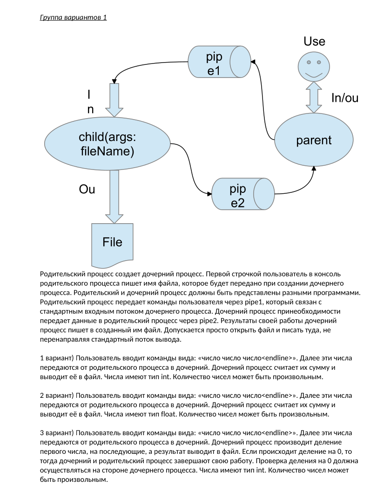

# Лабораторная работа 2. Процессы и каналы (вариант 3)



## Задание

Родительский процесс (parent) создаёт дочерний (child). Это две разные программы.

1. Пользователь вводит в parent имя файла, parent передаёт его child при запуске.
2. Затем пользователь вводит строки вида `число число число`. Parent пересылает их в child через pipe1, подключённый к стандартному вводу child.
3. Child делит первое число на все последующие (числа типа int, количество произвольное) и записывает результат в файл.
4. При делении на 0 завершаются оба процесса. Проверка выполняется в child, а parent узнаёт о ней через pipe2.

Схема взаимодействия:

```
пользователь --> parent --pipe1--> stdin  child --> файл
                   ^                        |
                   +--------- pipe2 <-- stdout
```

## Сборка и запуск

```
make          # собрать parent и child
./parent      # запускать из папки проекта: parent ищет ./child рядом с собой
make clean    # удалить бинарники
```

Пример работы:

```
$ ./parent
[parent 5120] имя файла: out.txt
[parent 5120] запущен child 5121
[child 5121] старт, parent 5120
100 5 2
ok
10 abc
некорректная строка
7 0
[parent 5120] деление на 0, выход
[child 5121] выход
[parent 5120] child 5121 завершился, код 0
$ cat out.txt
10
```

Работу можно завершить без деления на 0 нажатием Ctrl+D (конец ввода).

## Структура проекта

| Файл | Содержимое |
|---|---|
| `parent.c` | создание каналов и процесса, пересылка строк, ожидание ответов, `waitpid` |
| `child.c` | открытие файла, чтение строк из stdin, запись результата, ответ в stdout |
| `utils.c`, `utils.h` | `divide_line` — разбор строки и деление; `die` — вывод ошибки и выход; коды протокола |
| `Makefile` | сборка обеих программ |

## Теория

### Процесс

Процесс — это программа в момент выполнения. У каждого процесса есть своё адресное пространство (код, данные, стек), идентификатор PID, таблица открытых файловых дескрипторов и родитель (PPID). Процессы изолированы друг от друга: один процесс не может напрямую прочитать переменные другого. Для обмена данными нужны механизмы ОС. Такие механизмы называются IPC (межпроцессное взаимодействие), и канал — один из них.

### Файловые дескрипторы

Дескриптор — это целое число, номер записи в таблице открытых файлов процесса. У каждого процесса с самого начала открыты три дескриптора:

| Номер | Имя | Обычно связан с |
|---|---|---|
| 0 | `STDIN_FILENO` | клавиатурой |
| 1 | `STDOUT_FILENO` | терминалом |
| 2 | `STDERR_FILENO` | терминалом |

Функции `read(fd, ...)` и `write(fd, ...)` работают с любым дескриптором одинаково: с файлом, терминалом или каналом. На этом построена вся лабораторная.

### fork

`fork()` создаёт копию текущего процесса. После вызова работают два процесса, и оба продолжают выполнение со следующей строки после `fork`. Отличить их можно по возвращаемому значению:

- в родителе `fork` возвращает PID ребёнка;
- в ребёнке `fork` возвращает 0;
- при ошибке возвращается -1, и ребёнок не создаётся.

Ребёнок получает копии всех открытых дескрипторов родителя. Поэтому канал, созданный до `fork`, доступен обоим процессам.

### exec

`execl("./child", "child", filename, NULL)` заменяет код текущего процесса на другую программу. PID при этом не меняется, открытые дескрипторы сохраняются. Если `exec` выполнился успешно, управление в старый код не возвращается никогда. Поэтому строка после `execl` выполняется только при ошибке.

Список аргументов: первым идёт путь к программе, затем `argv[0]` (имя программы), затем остальные аргументы. Список обязательно заканчивается `NULL`.

Создание процесса разбито на два шага (`fork` и `exec`) как раз для того, чтобы между ними ребёнок мог настроить себе окружение, например подменить stdin и stdout.

### pipe

`pipe(fd)` создаёт канал — однонаправленную очередь байтов в памяти ядра:

- `fd[0]` — конец для чтения;
- `fd[1]` — конец для записи.

Свойства канала, важные для лабораторной:

- `read` из пустого канала блокирует процесс, пока в канал не запишут данные.
- `read` возвращает 0 (конец файла, EOF) только тогда, когда закрыты **все** дескрипторы записи этого канала во всех процессах.
- `write` в канал, у которого не осталось читателей, посылает процессу сигнал `SIGPIPE`. По умолчанию этот сигнал убивает процесс.
- Канал не хранит границы сообщений. Это поток байтов, и строки внутри него разделяются только символом `\n`.

### dup2

`dup2(old, new)` делает дескриптор `new` копией `old`. Если `new` был открыт, он предварительно закрывается. Вызов `dup2(p1[0], STDIN_FILENO)` означает: «теперь дескриптор 0 (stdin) указывает на канал pipe1». После этого программа, которая читает stdin, на самом деле читает канал и не знает об этом.

После `dup2` исходный дескриптор больше не нужен, и его закрывают, чтобы не держать лишние ссылки на канал.

### waitpid и зомби

Когда ребёнок завершается, ядро хранит его код возврата, пока родитель не заберёт его вызовом `waitpid`. Завершившийся, но не «забранный» процесс называется зомби. Он висит в таблице процессов. Поэтому parent в конце обязательно вызывает `waitpid`.

## Как работает программа

### Протокол обмена

Parent и child работают синхронно:

1. Parent отправляет в pipe1 одну строку.
2. Parent вызывает `read` из pipe2 и засыпает, пока не придёт ответ.
3. Child читает строку, считает результат, пишет его в файл и отправляет в pipe2 ровно один байт.
4. Parent просыпается, обрабатывает ответ и переходит к следующей строке.

Коды ответа (`utils.h`):

| Байт | Значение | Действие parent |
|---|---|---|
| `O` | строка обработана, результат в файле | печатает `ok`, продолжает |
| `E` | строка некорректна | печатает сообщение, продолжает |
| `Z` | деление на 0, child завершается | выходит из цикла, завершается |

Благодаря синхронности parent всегда знает состояние child, и между ними не возникает гонок.

### parent.c

1. `signal(SIGPIPE, SIG_IGN)` отключает гибель от `SIGPIPE`. Если child неожиданно умер, `write` в pipe1 просто вернёт -1 (ошибка `EPIPE`), и parent корректно обработает её.
2. `getline` читает имя файла, `strcspn` отрезает от него символ `\n`.
3. `pipe(p1)` и `pipe(p2)` создают два канала. Их нужно создать до `fork`, чтобы ребёнок унаследовал дескрипторы.
4. `fork()` делит выполнение на две ветки.
5. Ветка ребёнка (`pid == 0`):
   - `dup2(p1[0], STDIN_FILENO)`: stdin теперь читает из pipe1;
   - `dup2(p2[1], STDOUT_FILENO)`: stdout теперь пишет в pipe2;
   - закрываются все четыре исходных дескриптора;
   - `execl` превращает процесс в программу `child`, имя файла передаётся в `argv[1]`.
6. Ветка родителя закрывает `p1[0]` и `p2[1]`, потому что эти концы использует только ребёнок. Если родитель оставит `p2[1]` открытым, то после смерти child `read` из pipe2 никогда не вернёт EOF, и parent зависнет.
7. Основной цикл: прочитать строку пользователя, записать её в `p1[1]` (если в конце нет `\n`, он дописывается, иначе child не узнает, что строка закончилась), прочитать один байт из `p2[0]`.
   - `read` вернул 0: child закрыл pipe2, значит, он завершился. Parent выходит из цикла.
   - Пришёл ответ `Z`: parent выходит из цикла.
8. После цикла: закрывается `p1[1]` (child получает EOF, если он ещё работает), закрывается `p2[0]`, `waitpid` дожидается ребёнка и забирает его код возврата.

### child.c

1. Проверяет, что имя файла передано в `argv[1]`.
2. `open(argv[1], O_WRONLY | O_CREAT | O_TRUNC, 0644)` открывает файл на запись. Флаги означают: только запись, создать, если файла нет, очистить, если он есть. Права `0644`: владелец читает и пишет, остальные только читают.
3. Цикл `getline(&line, &cap, stdin)`. Child читает stdin и не знает, что это канал. `getline` возвращает -1, когда parent закрыл pipe1 (EOF).
4. `divide_line` вычисляет результат. При успехе `dprintf(fd, "%d\n", res)` записывает его в файл (`dprintf` — это аналог `printf` для файлового дескриптора).
5. `write(STDOUT_FILENO, &resp, 1)` отправляет ответ parent. Stdout здесь — это pipe2. Используется `write`, а не `printf`, потому что `printf` буферизует вывод, и ответ мог бы застрять в буфере, пока parent ждёт.
6. При делении на 0 child отправляет `Z` и выходит из цикла.
7. Отладочные сообщения пишутся в stderr. Он не перенаправлялся и остался терминалом, поэтому сообщения child видны на экране.

### utils.c

`divide_line` разбирает строку функцией `strtol`. Она читает число с текущей позиции, пропуская пробелы, и через параметр `end` сообщает, где число закончилось. Если `end` совпал с началом, значит, число не прочитано и чисел больше нет.

Проверки:

- в строке нет ни одного числа, значит, ошибка;
- число не помещается в int (`errno == ERANGE` или выход за `INT_MIN`/`INT_MAX`), значит, ошибка;
- делитель равен 0, значит, деление на ноль;
- после чисел остались не пробельные символы (например, `10 abc`), значит, ошибка.

Промежуточный результат хранится в `long`. Это нужно для случая `-2147483648 / -1`: в int такое деление не помещается и вызывает аварийное завершение процесса (SIGFPE), а в `long` результат вычисляется нормально и затем отсекается проверкой диапазона.

`die(msg)` вызывает `perror(msg)`, который печатает сообщение и текстовое описание ошибки из `errno`, и завершает процесс с кодом 1.

## Обработка ошибок и крайние случаи

| Ситуация | Поведение |
|---|---|
| ошибка `pipe`, `fork`, `dup2`, `execl`, `open`, `waitpid` | сообщение через `perror`, завершение |
| child не смог открыть файл | child выходит, `read` в parent возвращает 0, parent сообщает об этом и завершается |
| строка без чисел или с посторонними символами | ответ `E`, работа продолжается |
| число вне диапазона int | ответ `E` |
| `-2147483648 -1` | ответ `E` (переполнение), процесс не падает |
| одно число в строке | результат — само число |
| деление на 0 | ответ `Z`, оба процесса завершаются |
| Ctrl+D | parent закрывает pipe1, child получает EOF и выходит |
| строка произвольной длины | `getline` сам выделяет нужную память |

Все дескрипторы закрываются, память от `getline` освобождается, родитель дожидается ребёнка через `waitpid`, поэтому зомби-процессов не остаётся.

## Проверка через strace

`strace` показывает системные вызовы программы. Флаг `-f` нужен, чтобы отслеживать и дочерний процесс.

```
strace -f -e trace=pipe2,clone,dup2,execve,openat,read,write,close,wait4 ./parent
```

Что нужно найти в выводе:

| Строка в strace | Что это |
|---|---|
| `pipe2([3, 4], 0) = 0` | создание pipe1 (`pipe` в коде) |
| `clone(...) = 5121` | создание ребёнка (`fork` в коде) |
| `[pid 5121] dup2(3, 0)` | stdin ребёнка подключается к pipe1 |
| `[pid 5121] execve("./child", ["child", "out.txt"], ...)` | запуск программы child |
| `[pid 5121] openat(..., "out.txt", O_WRONLY\|O_CREAT\|O_TRUNC, 0644)` | открытие файла (`open` в коде) |
| `[pid 5120] write(4, "100 5 2\n", 8)` | parent пишет строку в pipe1 |
| `[pid 5121] read(0, "100 5 2\n", ...)` | child читает её из stdin |
| `[pid 5121] write(1, "O", 1)` | child отвечает в pipe2 |
| `wait4(5121, ...)` | ожидание ребёнка (`waitpid` в коде) |

Имена в strace отличаются от кода, потому что библиотека glibc вызывает более новые версии системных вызовов: `fork` реализован через `clone`, `pipe` через `pipe2`, `open` через `openat`, `waitpid` через `wait4`.

Проверить отсутствие зомби можно командой `ps aux | grep defunct` во время или после работы программы.